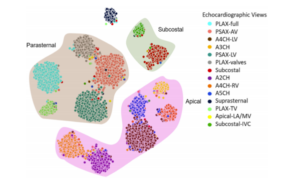
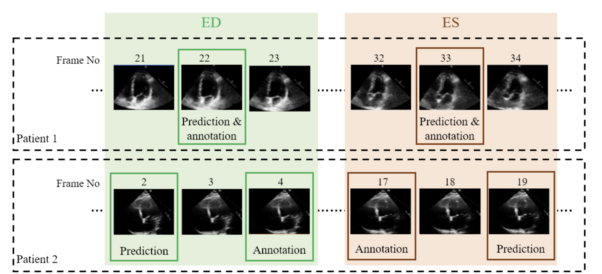

<h1 align="center">🫀 EchoForge</h1>

<p align="center"><b>Pretrained deep learning models for echocardiography</b><br>TensorFlow/Keras · Hugging Face · THRIVE Centre</p>

**EchoForge** is a modular deep learning library built for echocardiographic image analysis. It provides seamless access to pretrained models for classification and segmentation, and will expand to include landmark detection, image quality assessment, and more.

The library is built using TensorFlow/Keras and integrates with models hosted on Hugging Face. It is designed for researchers, clinicians, and ML developers working with cardiac ultrasound imaging.


**From View Classification to Segmentation and Timing Detection — All in One Library**

#### View Classification  


#### LV Segmentation  


#### Phase Detection (ED vs ES Labelling)  



---

## 🔧 Features

- Pretrained model access (Hugging Face integration)
- Modular and scalable model zoo
- Supports both private and public Hugging Face repositories
- Central `load_model()` interface for dynamic loading
- Architecture-ready for classification, segmentation, landmarking, and timing estimation
- Caches downloaded models locally to avoid repeated downloads

---
<!-- 
## 📦 Installation

```bash
git clone https://github.com/intsav/EchoForge.git
cd EchoForge
pip install -e .
``` -->
## 📦 Installation

EchoForge can be installed in two ways depending on your workflow:  
a standard local installation, or installation inside a TensorFlow Docker/Jupyter environment.

---

### 🔧 Standard Installation (Local / Virtual Environment)

Use this option if you are installing EchoForge on your own machine or in a Python virtual environment.

```bash
git clone https://github.com/thrive-centre/EchoForge.git
cd EchoForge
pip install -e .
```
This installs EchoForge in editable mode, allowing you to update the source code and test changes instantly.

## 🐋 Installation Inside a TensorFlow Docker (GPU + Jupyter)

If you're running EchoForge inside a TensorFlow Docker container such as:

```bash
tensorflow/tensorflow:2.13.0-gpu-jupyter
```

then install it using the following commands inside your notebook or container terminal:

```bash
# Clone the EchoForge repository
!git clone https://github.com/thrive-centre/EchoForge.git

# Install EchoForge from the mounted directory
!pip install -e /tf/notebooks/EchoForge
```

>Note:
Update the path /tf/notebooks/EchoForge if your directory structure differs.
This is simply where your repo is located inside the container.
---

## Importing The Model 

```python
from echoforge import load_model

# Load any model by name from the registry
model = load_model("EchoFine_classifier", pretrained=True)
```
---

## 🧾 Model Zoo

| Model | Task | `load_model` name | Docs | Weights (Hugging Face) | Datasets |
|---|---|---|---|---|---|
| **EchoFine Classifier** | 47-class view classification | `EchoFine_classifier` | [README](echoforge/classification/models/EchoFine/README.md) | [thrive-2025/EchoView47](https://huggingface.co/thrive-2025/EchoView47) | [TTE47](https://www.thrive-centre.com/datasets/TTE47) |
| **EchoFine Contrastive Encoder** | Self-supervised view encoder | `EchoFine_contrastive_encoder` | [README](echoforge/classification/models/EchoFine/README.md) | [thrive-2025/EchoView47](https://huggingface.co/thrive-2025/EchoView47) | [TTE47](https://www.thrive-centre.com/datasets/TTE47) |
| **EchoFine TMED2** | 5-class TMED2 view classification | `EchoFine_TMED2` | [README](echoforge/classification/models/EchoFine/README.md) | [thrive-2025/test_echoforge](https://huggingface.co/thrive-2025/test_echoforge) | TMED2 |
| **EchoSDNet** | Single vs. dual-view classification | `EchoSDNet` | [README](echoforge/classification/models/EchoSDNet/README.md) | [thrive-2025/EchoSDNet](https://huggingface.co/thrive-2025/EchoSDNet) | UNITY |
| **EchoLVSNet** | LV segmentation | `EchoLVSNet` | [README](echoforge/segmentation/models/echolvsnet/README.md) | [thrive-2025/echolvsnet](https://huggingface.co/thrive-2025/echolvsnet) | UNITY |
| **EchoPDNet** | ED/ES phase detection (docs only) | _coming soon_ | [README](echoforge/phasedetection/models/echopdnet/README.md) | – | – |

### 🤗 All Hugging Face Model Links
Central list: [`echoforge/config/model_links.json`](echoforge/config/model_links.json). Entries marked `PLACEHOLDER` are dummy links to be updated once published.

| Model | Hugging Face |
|---|---|
| EchoFine Classifier / Contrastive Encoder | [thrive-2025/EchoView47](https://huggingface.co/thrive-2025/EchoView47) |
| EchoFine TMED2 | [thrive-2025/test_echoforge](https://huggingface.co/thrive-2025/test_echoforge) |
| EchoSDNet | [thrive-2025/EchoSDNet](https://huggingface.co/thrive-2025/EchoSDNet) |
| EchoLVSNet | [thrive-2025/echolvsnet](https://huggingface.co/thrive-2025/echolvsnet) |
| EchoPDNet | [PLACEHOLDER](https://huggingface.co/thrive-2025/PLACEHOLDER-EchoPDNet) |
| EchoFine UNITY ResNet50 | [PLACEHOLDER](https://huggingface.co/thrive-2025/PLACEHOLDER-EchoFine-UNITY) |
| EchoFine TMED2 ResNet50 | [PLACEHOLDER](https://huggingface.co/thrive-2025/PLACEHOLDER-EchoFine-TMED2) |
| A4C_ROT | [PLACEHOLDER](https://huggingface.co/thrive-2025/PLACEHOLDER-A4C-ROT) |


### 🔁 Use any model by changing its name
```python
from echoforge import load_model, list_models

print(list_models())                  # every model in the registry
model = load_model("EchoLVSNet")      # just swap the name
```
To publish a new model, add `{"repo_id": ..., "filename": ...}` under its name in `echoforge/config/registry.json` (replace the `PLACEHOLDER` entries). Registry-only models load via `tf.keras.models.load_model`.

### 🧪 Baseline & backbone variants (full models)
Each loads the complete model (architecture + weights) from Hugging Face:
```python
from echoforge import load_model
model = load_model("Xception_TTE47_baseline")          # also: SwinTransformerV2, EfficientNetV2, ViT, ConvNeXt,
                                                       # DenseNet121, ResNet50, ResNet101, SwinTransformerV2-T, ConvNeXt-T, ViT-S
clf = load_model("EchoFine_classifier_ConvNeXt-T")     # also SwinTransformerV2-T, ViT-S
enc = load_model("EchoFine_contrastive_encoder_ViT-S")
```
Registry entries support `repo_id` + `filename` (single `.h5`/`.keras`), or `repo_id` with `filename: null` (whole repo / SavedModel folder), plus an optional `subfolder`. Names ignore case and `-` vs `_`.

### 📚 Modules
- [Classification](echoforge/classification/README.md)
- [Segmentation](echoforge/segmentation/README.md)
- [Phase Detection](echoforge/phasedetection/README.md)

### 🔗 THRIVE Resources
- 🏠 [THRIVE Centre](https://www.thrive-centre.com)
- 🗂️ [Datasets](https://www.thrive-centre.com/datasets) (e.g. [TTE47](https://www.thrive-centre.com/datasets/TTE47), [UnityLV-MultiX](https://www.thrive-centre.com/datasets/UnityLV-MultiX))
- 🤗 [THRIVE on Hugging Face](https://huggingface.co/thrive-2025)

> Registered models are listed in `echoforge/config/registry.json`. Private repos need the `HF_TOKEN` environment variable.

---

## 👥 Credits

- Developed by: **THRIVE Centre**
- Research Group: **Intelligent Sensing and Vision**
- Clinical Collaboration: **Faculty of Medicine, Imperial College London**

---

## 📎 Notes

- All models are downloaded once and cached in `~/.echoforge/models/`
- You can load models without pretrained weights for retraining
- Future versions will include `torch` support and ONNX export